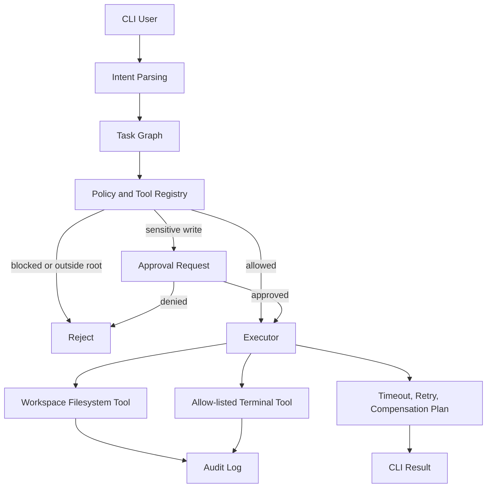

# ARIEXUS – Secure Agent Runtime & Orchestration Layer

Production-ready MVP skeleton implementing:

- Typed task graphs (Pydantic)
- Tool registry with sandboxed filesystem + allow-listed terminal
- Approval system for risky actions
- Immutable audit logging
- Retry / timeout / compensation planning
- Clean CLI

## Quick Start

```bash
# 1. Clone / enter project
cd ariexus

# 2. Virtualenv
python3 -m venv venv
source venv/bin/activate          # Windows: venv\Scripts\activate

# 3. Install
pip install -r requirements.txt

# 4. Initialize workspace
python -m arxus.cli init

# 5. Chat
python -m arxus.cli chat "list the current directory"
python -m arxus.cli chat 'create a file called "hello.txt" with content "Hello ARIEXUS"'
python -m arxus.cli chat "read hello.txt"
```

## Commands

| Command | Description |
|---------|-------------|
| `python -m arxus.cli init` | Create workspace |
| `python -m arxus.cli chat "..."` | Parse intent → execute task graph |
| `python -m arxus.cli approvals` | List pending approvals |
| `python -m arxus.cli approve <id>` | Approve a request |
| `python -m arxus.cli deny <id>` | Deny a request |
| `python -m arxus.cli audit` | Show recent audit events |

## Security (MVP)

- Filesystem tool sandboxed to `./workspace`
- Terminal only allows safe commands (git, ls, echo, python, …)
- Write operations require approval
- All tool calls are audited

<!-- X4-APEX-DIAGRAM-START:ariexus -->



<!-- X4-APEX-DIAGRAM-END:ariexus -->

## Project Layout

```
ariexus/
├── arxus/
│   ├── cli.py
│   ├── models.py
│   ├── executor.py
│   ├── runtime.py
│   ├── approval.py
│   ├── audit.py
│   └── tools/
│       ├── base.py
│       ├── filesystem.py
│       └── terminal.py
├── requirements.txt
└── README.md
```

## Next Steps

- Replace keyword intent parser with LLM structured output
- Add more tools (git, HTTP, browser)
- Web UI for approvals
- Agent capabilities (researcher / engineer)

## APEX Architecture Map

> Status: architecture documentation; implementation and deployment claims require independent verification.

**Evidence note:** Confirm that path containment, approval binding, retries, and audit behavior are implemented and tested; the diagram itself is not a security attestation.

